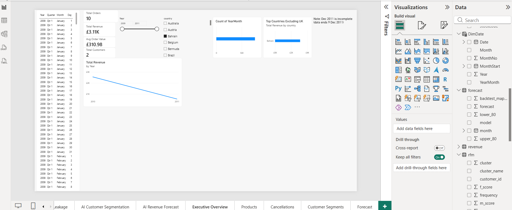
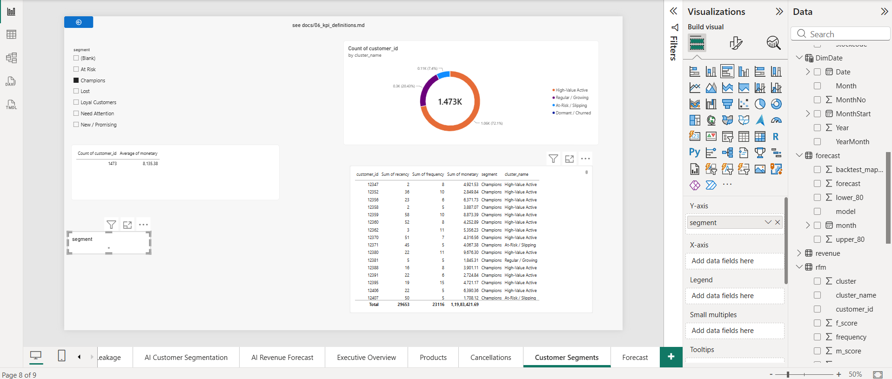
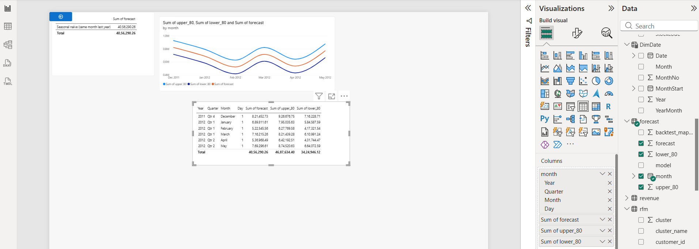
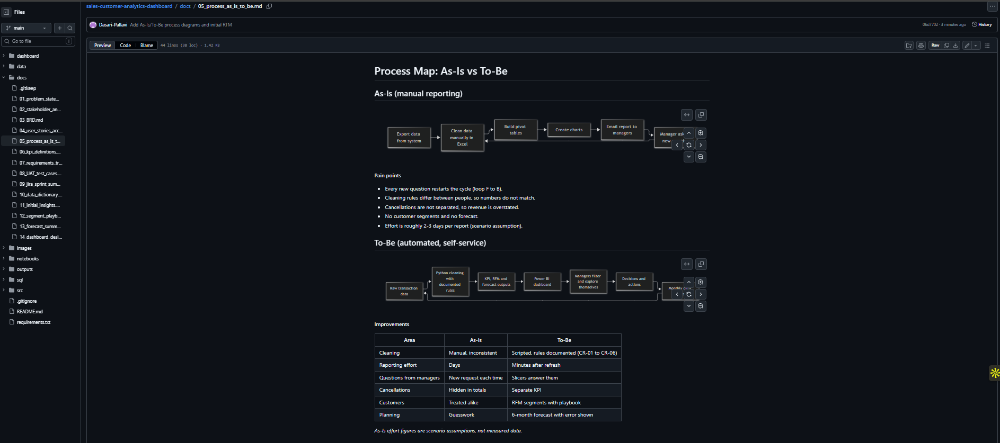
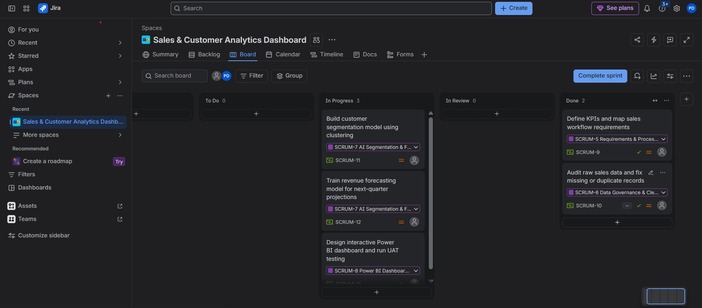

# AI-Powered Sales & Customer Analytics Dashboard

A Business Analyst portfolio project: from business problem and requirements
(BRD, user stories, acceptance criteria, Jira/Scrum) to data analysis, customer
segmentation, forecasting and a Power BI dashboard.

## Business problem
Reporting for an online gift-ware retailer is manual and slow. Management cannot see
revenue trends, cancellation losses or customer segments, and has no forecast.
(Retailer scenario built on a public dataset; business context is simulated.)

## Objectives
1. One dashboard for revenue, orders and customer KPIs
2. Track revenue lost to cancellations
3. Segment customers for targeted marketing
4. Forecast the next 6 months of revenue
5. Reduce manual reporting effort

## My role: Business Analyst
- Documented requirements: BRD, 5 user stories with acceptance criteria, KPI definitions
- Managed work in Jira (Scrum): 6 epics, 3 one-week sprints
- Defined data rules, analysed data and translated results into recommendations
- Built a traceability matrix and ran UAT (17 test cases plus automated checks)

## Dataset
[Online Retail II (Kaggle)](https://www.kaggle.com/datasets/mashlyn/online-retail-ii-uci):
about 1.07M transaction lines of a UK online retailer, Dec 2009 to Dec 2011.
The raw file is not stored here; download it into `data/raw/`.

## Tools
Jira, Python (pandas, scikit-learn, statsmodels, matplotlib), SQL, Power BI, Git/GitHub, draw.io/Mermaid

## Workflow
Problem and stakeholders > BRD and user stories > data quality check > cleaning
> KPIs > RFM and K-Means > forecast > Power BI dashboard > UAT > recommendations

## Key results

| Area | Result |
|---|---|
| Revenue / Orders / Customers | £[ ] / [ ] / [ ] |
| Cancellation rate | [ ]% of revenue |
| Repeat customers | [ ]% |
| Champions + Loyal | [ ]% of customers, [ ]% of revenue |
| Forecast accuracy | MAPE [ ]% on a 4-month back-test |
| UAT | 17 of 17 tests passed |

## Top recommendations
1. **Peak Inventory Planning:** Raise stock 4–6 weeks ahead of September–November seasonal surges using the 6-month forecast confidence range.
2. **At-Risk Customer Win-Back:** Launch a targeted retention campaign for the [ ] At-Risk customers holding £[ ] in historical revenue.
3. **International Market Expansion:** Reduce UK revenue dependency ([ ]%) by running targeted growth campaigns in the top 3 non-UK markets ([ ], [ ], [ ]).

Full list: [docs/15_final_recommendations.md](docs/15_final_recommendations.md)

## Screenshots

| Segments | Forecast |
|---|---|
|  |  |

## Documentation

| Document | File |
|---|---|
| Problem statement | [docs/01](docs/01_problem_statement.md) |
| Stakeholders | [docs/02](docs/02_stakeholder_analysis.md) |
| BRD | [docs/03](docs/03_BRD.md) |
| User stories | [docs/04](docs/04_user_stories_acceptance_criteria.md) |
| As-Is / To-Be | [docs/05](docs/05_process_as_is_to_be.md) |
| KPI definitions | [docs/06](docs/06_kpi_definitions.md) |
| Traceability matrix | [docs/07](docs/07_requirements_traceability_matrix.md) |
| UAT | [docs/08](docs/08_UAT_test_cases.md) |
| Jira summary | [docs/09](docs/09_jira_sprint_summary.md) |
| Data dictionary | [docs/10](docs/10_data_dictionary.md) |
| Insights | [docs/11](docs/11_initial_insights.md) |
| Segment playbook | [docs/12](docs/12_segment_playbook.md) |
| Forecast summary | [docs/13](docs/13_forecast_summary.md) |
| Dashboard design | [docs/14](docs/14_dashboard_design.md) |
| Recommendations | [docs/15](docs/15_final_recommendations.md) |

## Folder structure
