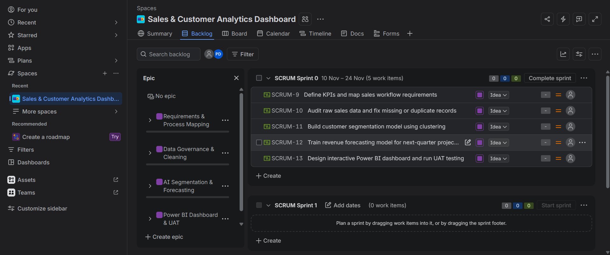
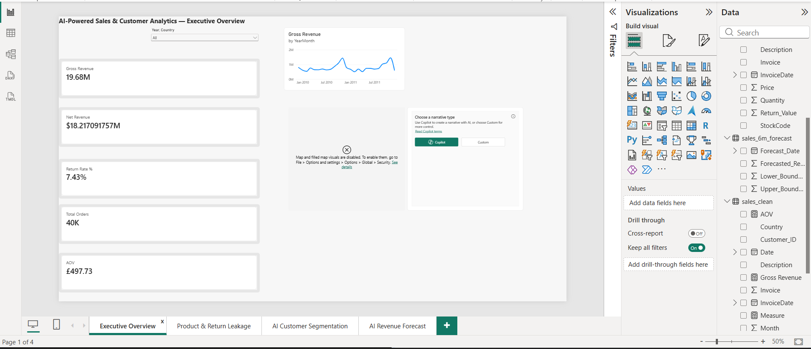
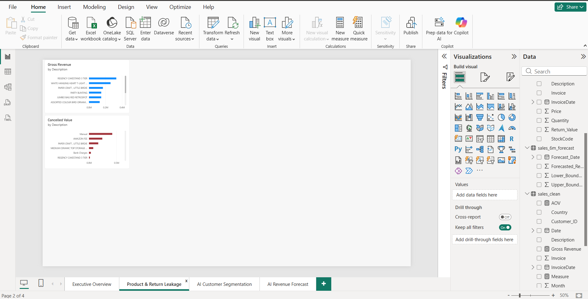
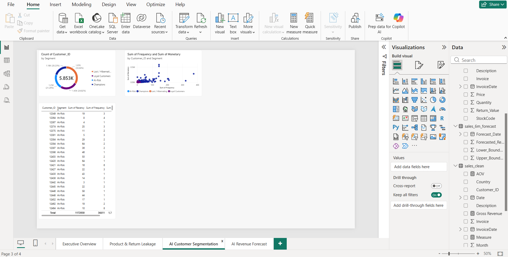
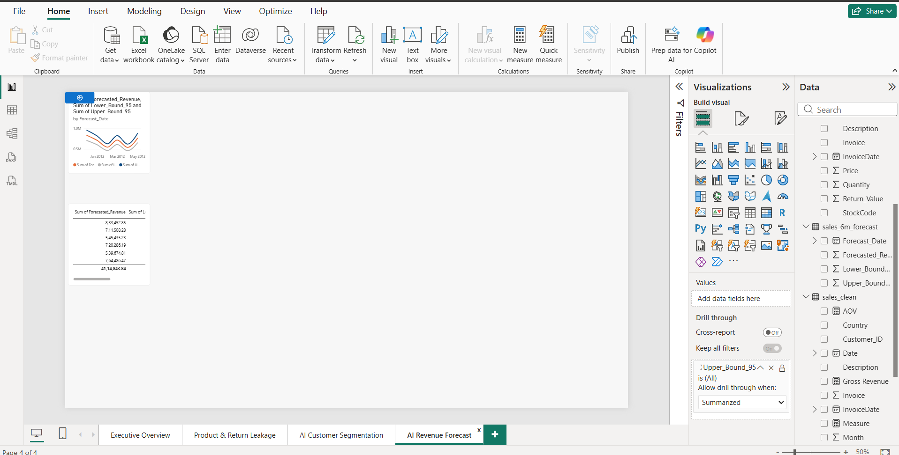

# AI-Powered Sales & Customer Analytics Dashboard

**Role:** Business Analyst | **Tools:** Jira (Scrum), Python, SQL, Power BI, Git/GitHub  
**Dataset:** [Online Retail II UCI (Kaggle)](https://kaggle.com)

## 📌 Business Problem & Objectives
A UK-based online giftware retailer processing over 1.06 million transactions (2009–2011) relied on manual spreadsheet reporting, resulting in delayed visibility, unquantified return losses, and untargeted marketing. 

This end-to-end Business Analysis project delivers an automated **4-page Power BI decision-support dashboard** backed by formal requirements documentation, Agile Scrum delivery, RFM + K-Means customer segmentation, and a 6-month statistical sales forecast.

### Scope & Data Governance
* **In-Scope:** Gross Revenue, Cancellations/Returns, Net Revenue (`Quantity × Price`), Average Order Value (AOV), Country-level performance, Repeat Customer Rate, RFM + K-Means clustering, and 6-month revenue forecasting.
* **Data Constraint (Out-of-Scope):** Cost of Goods Sold (COGS) is unavailable in the source dataset; profitability metrics are documented as out-of-scope in the BRD. Guest transactions (`Customer ID` null) are retained for store-wide revenue totals and excluded from customer-level RFM clustering.

---

## 🛠️ Agile Delivery & Business Analysis Artifacts
* **Problem Statement & RACI Matrix:** `docs/01_problem_statement.md`, `docs/02_stakeholder_analysis.md`
* **Business Requirements Document (BRD):** `docs/03_BRD.md`
* **User Stories & Acceptance Criteria:** `docs/04_user_stories_acceptance_criteria.md`
* **KPI Definitions & Data Dictionary:** `docs/06_kpi_definitions.md`, `docs/10_data_dictionary.md`
* **Traceability & Testing:** `docs/07_requirements_traceability_matrix.md`, `docs/08_UAT_test_cases.md`
* **Jira Scrum Execution:** Managed 4 Epics and 12 User Stories across 3 Sprints (`docs/09_jira_sprint_summary.md`).

### Jira Scrum Board & Backlog

---

## 📊 Power BI Dashboard Preview (4 Pages)

### 1. Executive Overview

### 2. Product & Return Leakage

### 3. AI Customer Segmentation (RFM + K-Means)

### 4. 6-Month AI Revenue Forecast

---

## 📈 Exploratory Data Analysis & AI Modeling Charts
* **Monthly Revenue Trend:** `outputs/charts/01_monthly_revenue_trend.png`
* **Top International Markets:** `outputs/charts/02_top_international_markets.png`
* **RFM Customer Clusters:** `outputs/charts/03_rfm_customer_segments.png`
* **6-Month Holt-Winters Forecast:** `outputs/charts/04_sales_6m_forecast.png`

---

## 📂 Repository Structure
* `docs/` — BRD, User Stories, Acceptance Criteria, KPI Definitions, RTM, UAT Logs, Data Dictionary, and Jira Summary
* `src/` — Python pipelines for data cleaning (`01_data_cleaning.py`) and EDA/RFM/forecasting (`02_eda_rfm_forecast.py`)
* `dashboard/` — Power BI Desktop file (`Sales_Customer_Analytics.pbix`)
* `outputs/` — Exported EDA/AI charts and final Executive Insights Report
* `images/` — Jira board screenshots and Power BI dashboard page captures
* `data/` — Raw and processed directory structure (raw CSV excluded via `.gitignore`; download from Kaggle link above)
