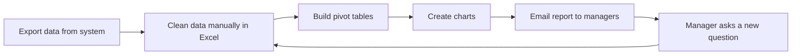
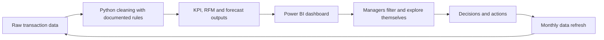

# Process Map: As-Is vs To-Be

## As-Is (manual reporting)

**Pain points**
- Every new question restarts the cycle (loop F to B).
- Cleaning rules differ between people, so numbers do not match.
- Cancellations are not separated, so revenue is overstated.
- No customer segments and no forecast.
- Effort is roughly 2-3 days per report (scenario assumption).

## To-Be (automated, self-service)

**Improvements**

| Area | As-Is | To-Be |
|---|---|---|
| Cleaning | Manual, inconsistent | Scripted, rules documented (CR-01 to CR-06) |
| Reporting effort | Days | Minutes after refresh |
| Questions from managers | New request each time | Slicers answer them |
| Cancellations | Hidden in totals | Separate KPI |
| Customers | Treated alike | RFM segments with playbook |
| Planning | Guesswork | 6-month forecast with error shown |

*As-Is effort figures are scenario assumptions, not measured data.*
